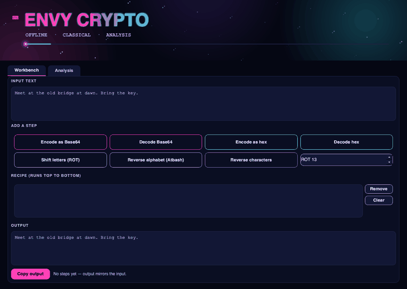
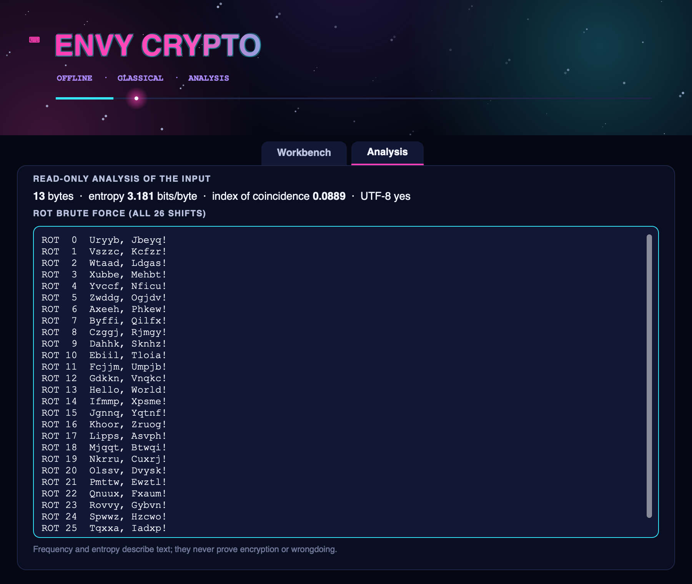

<p align="center">
  
</p>

<p align="center"><b>Encode, run classical ciphers, and analyze text — offline, in a real native app window.</b><br />
Base64 and hex, ROT and Atbash, chained recipes, and frequency analysis with a ROT brute force. From ENVY BLACK VEIL, as a standalone app.</p>

<p align="center">
  <a href="https://github.com/xzchick/envy-crypto-workbench/actions/workflows/tests.yml"></a>
</p>
<p align="center">
  
  
  <br />
  
  
  
</p>
<p align="center">
  <a href="https://github.com/xzchick/envy-crypto-workbench/releases/latest"></a>
  <a href="#verifying-a-release"></a>
  <a href="https://github.com/xzchick/envy-crypto-workbench/releases/latest"></a>
  <a href="https://github.com/xzchick/homebrew-envy"></a>
  <a href="#install-on-linux"></a>
  <a href="https://xzchick.github.io/homebrew-envy/"></a>
</p>

<p align="center">
  <a href="#install"><b>Install</b></a> ·
  <a href="#works-on">Compatibility</a> ·
  <a href="#using-it">Using it</a> ·
  <a href="#honest-by-design">What it isn't</a> ·
  <a href="#build--test">Build</a>
</p>

<p align="center">
  
</p>

<p align="center"><sub>A real native window — not a browser view. The title pulses, the stars twinkle, and a light travels the accent bar.</sub></p>

<a name="features"></a>




Paste text, add operations, and watch the result update live. Stack up to 16 steps into a **recipe** (say, Base64-decode then ROT13) and run them top to bottom. The **Analysis** tab shows byte and letter frequency, Shannon entropy, the index of coincidence, and a **ROT brute force** that prints all 26 shifts at once — enough to crack a classic cipher puzzle in seconds.

<p align="center">
  
</p>

<a name="works-on"></a>


<p align="center">
  
  
  
</p>



### Requirements

| | 🍎 macOS | 🪟 Windows | 🐧 Linux |
|---|---|---|---|
| **OS version** | macOS 11 Big Sur or newer | Windows 10 or 11 (64-bit) | A current x86_64 or arm64 desktop |
| **Standalone bundle** | Nothing else to install | Nothing else to install | Standard desktop libraries (X11 or Wayland) |
| **From pip** | Python 3.10+ | Python 3.10+ | Python 3.10+ and a desktop session |
| **Dependencies** | None (pure Python + Qt) | None | None |
| **Network** | None, ever | None, ever | None, ever |

<a name="install"></a>


A **standalone bundle** that needs no Python, or **pip** if you already have Python 3.10+.

### Standalone bundle (no Python)

Download a bundle from the [latest release](https://github.com/xzchick/envy-crypto-workbench/releases/latest):

| File | System | Run it |
|---|---|---|
| `envy-crypto-v0.2.0-macos-arm64.tar.gz` | macOS (Apple Silicon) | `tar -xzf` it, then open `envy-crypto` |
| `envy-crypto-v0.2.0-windows-x86_64.zip` | Windows (64-bit) | Unzip, then run `envy-crypto.exe` |
| `envy-crypto-v0.2.0-linux-x86_64.tar.gz` | Linux (64-bit) | `tar -xzf` it, then run `./envy-crypto` |
| `envy_crypto_workbench-0.2.0-py3-none-any.whl` | Any OS with Python 3.10+ | `pip install` the wheel |
| `SHA256SUMS.txt` | — | Verify your download first |

Running `envy-crypto` with no arguments opens the window.

### Homebrew (macOS, Apple Silicon)

```sh
brew install --cask xzchick/envy/envy-crypto
```

These builds aren't notarized, so if macOS blocks it on first run, add `--no-quarantine` to that command. Intel Macs, Linux and Windows: use the standalone bundle above.

### From pip (Python 3.10+)

```sh
git clone https://github.com/xzchick/envy-crypto-workbench.git
cd envy-crypto-workbench
python3 -m venv .venv
. .venv/bin/activate          # Windows: .venv\Scripts\activate
pip install .
envy-crypto                    # opens the window
```

<a name="using-it"></a>


**In the window**

- Type or paste text, then click operations to add them to the recipe; the output updates live.
- Set the ROT shift with the spinner before adding a **Shift letters (ROT)** step.
- Open the **Analysis** tab for entropy, index of coincidence and the 26-shift ROT brute force.

**In the terminal**

```sh
envy-crypto run --op base64-decode message.txt out.txt
envy-crypto run --op rot --shift 13 message.txt out.txt
envy-crypto analyze cipher.txt          # prints frequency, entropy and ROT previews
envy-crypto recipe --recipe steps.json in.txt out.txt
```

Every `run` writes a **new** file and never overwrites your original.

<a name="honest-by-design"></a>


These are **reversible encodings and teaching ciphers**, not security. Base64, hex, ROT and Atbash can be undone by anyone — they hide nothing. Frequency and entropy **describe** text; they never prove that something is encrypted, random, or evidence of wrongdoing.

> [!IMPORTANT]
> To actually protect a file, use **[ENVY Vault](https://github.com/xzchick/envy-vault)** (AES-256-GCM), not this workbench.

<a name="build--test"></a>


```sh
python -m unittest discover -s tests -v          # unit tests (no display needed)
pip install pyinstaller build
python scripts/build_release_bundle.py           # standalone bundle + wheel + sdist + checksums
python scripts/smoke_test_release.py             # launch the built bundle and check it runs
```

CI runs all of this on Ubuntu, Windows and macOS for every push. Regenerate the README artwork with `python scripts/render_readme_art.py`.

## Security

Security policy and private vulnerability reporting: **[SECURITY.md](SECURITY.md)**. What ENVY Cryptography Workbench does and does not protect against: **[THREAT_MODEL.md](THREAT_MODEL.md)**.

## Roadmap

Planned work for **v0.3** — signed releases, PyPI, more codecs and shareable recipes — is tracked in [#11](https://github.com/xzchick/envy-crypto-workbench/issues/11).

## Install on Linux

One command (downloads the latest release bundle, verifies it against the signed
`SHA256SUMS`, and installs under `~/.local` with a desktop entry — no root):

```sh
curl -fsSL https://raw.githubusercontent.com/xzchick/envy-crypto-workbench/main/install.sh | sh
```

Prefer to inspect first? Download `install.sh`, read it, then run `sh install.sh`.
Uninstall instructions are printed at the end of a successful install.

## Verifying a release

Each release's `SHA256SUMS.txt` is signed with [Sigstore](https://www.sigstore.dev/)
keyless signing — there is no key to trust: the signature is bound to this repository's
GitHub Actions identity and recorded in the public Rekor transparency log.

```sh
# 1. check your download against the signed checksums
sha256sum -c SHA256SUMS.txt            # or: shasum -a 256 -c SHA256SUMS.txt

# 2. verify the checksums file's signature (needs cosign)
cosign verify-blob \
  --bundle SHA256SUMS.txt.sigstore.json \
  --certificate-identity-regexp 'https://github.com/xzchick/envy-crypto-workbench/.github/workflows/release.yml@.*' \
  --certificate-oidc-issuer https://token.actions.githubusercontent.com \
  SHA256SUMS.txt
```

## The ENVY BLACK VEIL suite

ENVY Cryptography Workbench is one of eleven standalone apps from **ENVY BLACK VEIL** — small native desktop tools that are offline by design: no network, no accounts, no telemetry, everything encrypted at rest.

| App | What it does |
|---|---|
| [ENVY Vault](https://github.com/xzchick/envy-vault) | Local AES-256 file encryption |
| [ENVY Veil](https://github.com/xzchick/envy-veil) | Steganography — hide an encrypted file in an image or audio carrier |
| [ENVY Hypothesis](https://github.com/xzchick/envy-hypothesis) | Analysis of Competing Hypotheses |
| [ENVY Oracle](https://github.com/xzchick/envy-oracle) | Forecast tracking with calibration scoring |
| [ENVY SkyWatch](https://github.com/xzchick/envy-skywatch) | Watchlists with offline content scanning |
| [ENVY Casebook](https://github.com/xzchick/envy-casebook) | Encrypted, revision-preserving case notes |
| **ENVY Cryptography Workbench** — *you are here* | Classical ciphers, encoding and text analysis |
| [ENVY Orbit](https://github.com/xzchick/envy-orbit) | Recurring-cadence tracking |
| [ENVY Ops Desk](https://github.com/xzchick/envy-ops-desk) | Operations plans with authenticated handoffs |
| [ENVY Evidence Vault](https://github.com/xzchick/envy-evidence-vault) | File intake with a hash-verified custody journal |
| [ENVY Integrity Monitor](https://github.com/xzchick/envy-integrity-monitor) | File-integrity baselines and change detection |

<p align="center"><sub>MIT licensed. Part of ENVY BLACK VEIL, packaged as a standalone app. Offline; no telemetry, no network, no accounts.</sub></p>
